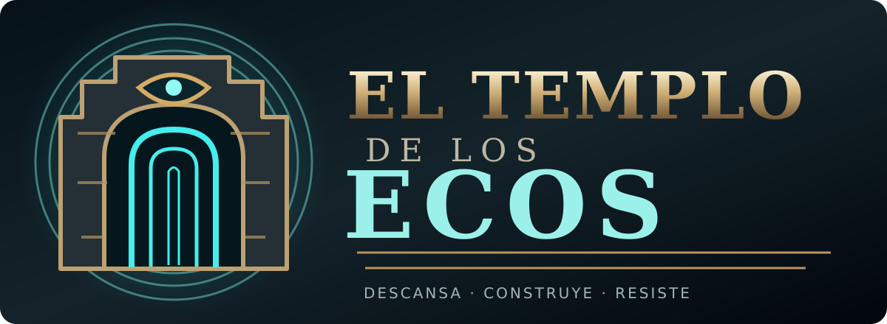
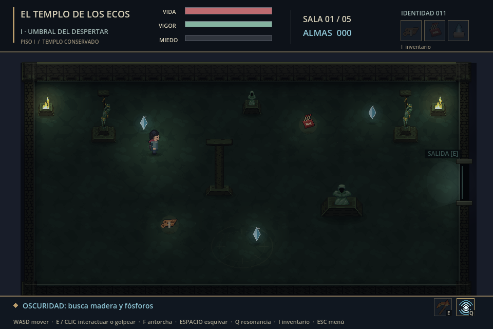
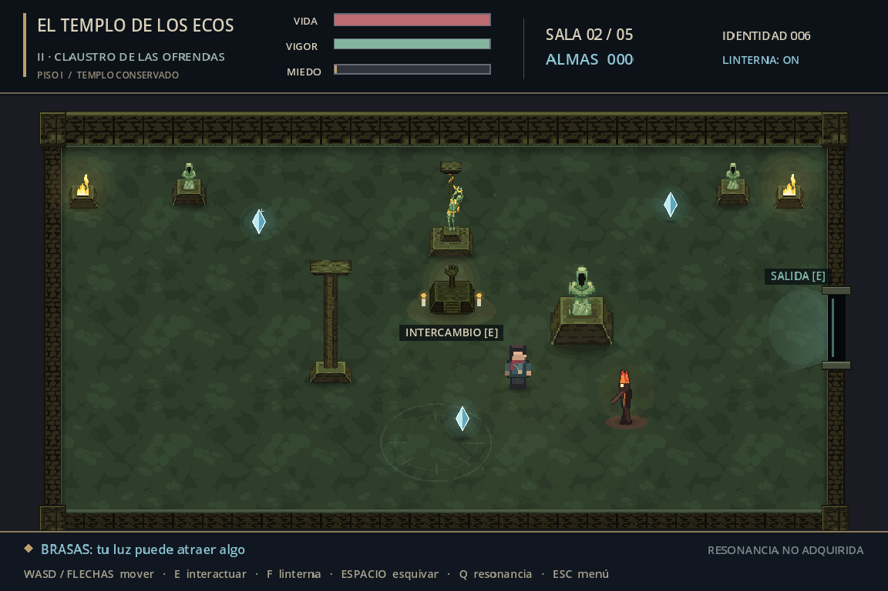
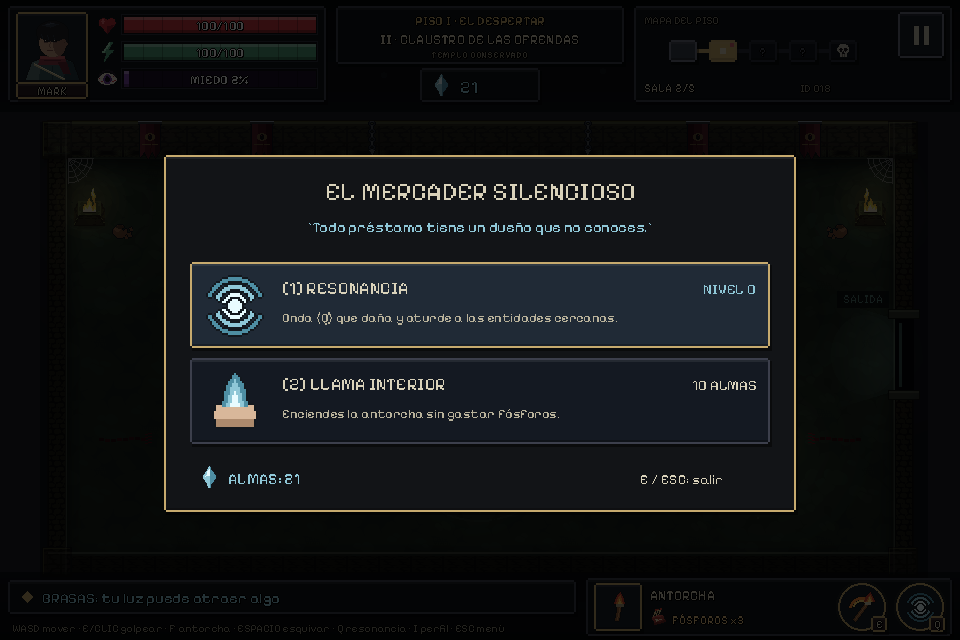
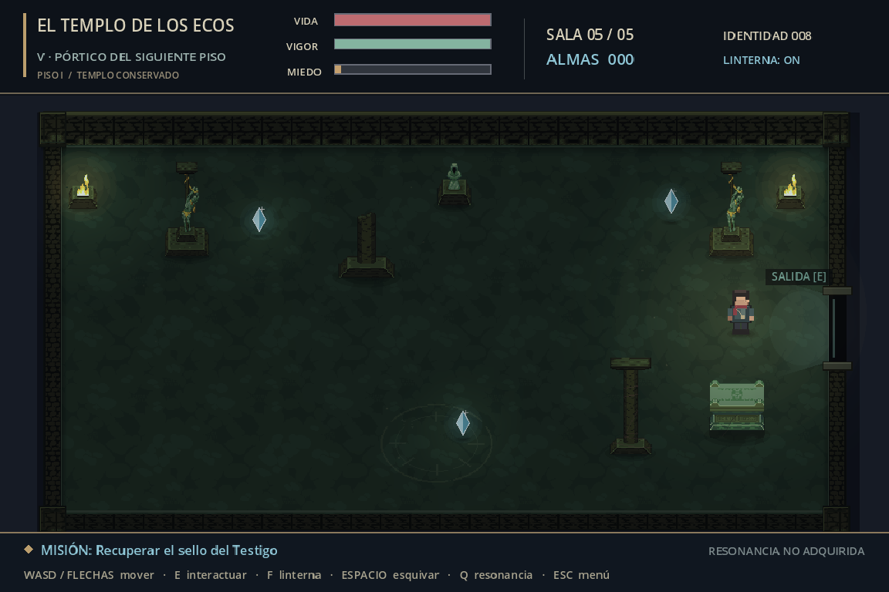
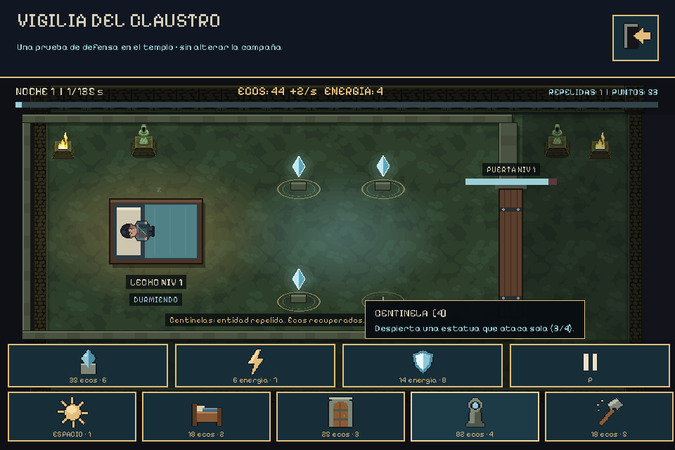
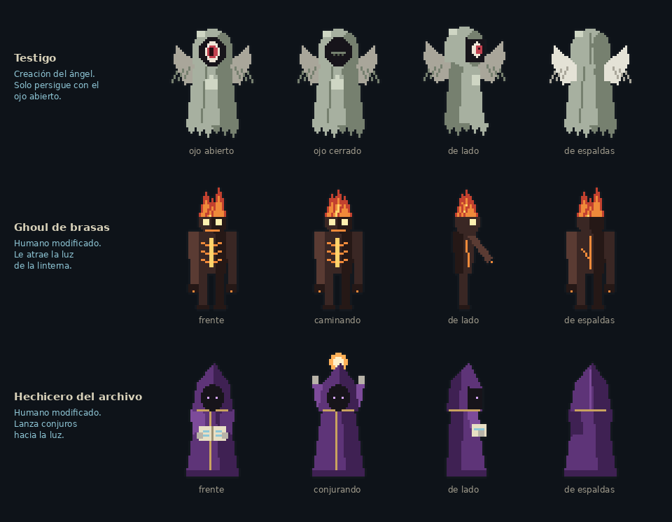
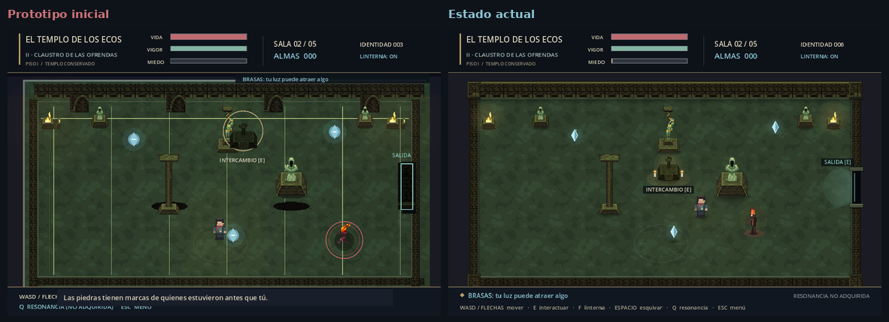

# El Templo de los Ecos



**Un lugar sagrado. Un sistema oculto. Un ciclo del que quizás no exista escapatoria.**

[](https://github.com/je7remy/el-templo-de-los-ecos/releases)
[](https://godotengine.org/)
[](https://github.com/je7remy/el-templo-de-los-ecos/actions/workflows/validar-godot.yml)
[](https://github.com/je7remy/el-templo-de-los-ecos/releases)

**El Templo de los Ecos** es un juego independiente de terror psicológico y cósmico, supervivencia y elementos roguelite, desarrollado en **Godot Engine 4** con **GDScript**. El jugador explora un templo cuyo funcionamiento desconoce. Cada entidad obedece reglas propias, y entenderlas vale tanto como cualquier habilidad.

> **Estado:** prototipo de un solo piso con cinco salas. Las misiones, entidades y estadísticas del prototipo no son canon definitivo del universo. No es un juego terminado.


*Captura real del juego en Godot. En la Sala del Testigo, moverse mientras el ojo del muro está abierto atrae a la entidad.*

## ¿Qué incluye el prototipo?

- **Un piso de cinco salas**: Umbral del despertar, Claustro de las ofrendas, Sala del Testigo, Archivo de los ausentes y Pórtico del siguiente piso.
- **Tres entidades con reglas que se pueden aprender**, con arte propio en vista cenital y cuatro direcciones:
  - **Testigo**: solo persigue si el ojo está abierto y el jugador se mueve.
  - **Ghoul de brasas**: le atrae la luz de la linterna.
  - **Hechicero del archivo**: lanza conjuros hacia la luz.
- **Exploración e interacción**: almas que se recogen al tocarlas, el sello del Testigo, la carta del archivo, el altar del Mercader Silencioso y una habilidad experimental (Resonancia).
- **Penumbra dinámica**: tu linterna, los braseros y las almas abren claros en la oscuridad; apagar la luz te esconde, pero también te ciega.
- **Peligro que se anuncia**: el ojo del Testigo tiembla antes de abrirse y el Hechicero carga su conjuro a la vista. Los golpes sacuden la pantalla y dan un breve margen de invulnerabilidad.
- **Música y sonido originales** que reaccionan al miedo y a la persecución.
- **Muerte 50/50**: el alma regresa (misma persona, con memoria y habilidades) o es absorbida y aparece un humano nuevo, sin recuerdos.
- **Vigilia del Claustro**: modo alternativo de defensa con refugios, lecho, puerta, centinelas y oleadas hasta el amanecer.
- **Salas editables en Godot**: arquitectura en `TileMapLayer`, objetos como `Sprite2D` con su colisión y marcadores para todas las posiciones de juego.
- **Controles táctiles para Android** y **pruebas automatizadas** con Godot 4.3 en GitHub Actions.

La idea narrativa central es que el templo no es una prisión convencional, sino parte de un sistema de explotación de almas. El antagonista permanece fuera de escena mientras el sistema sigue funcionando.

## Galería

Todas las imágenes, salvo las tres láminas finales, son capturas reales del juego ejecutándose en Godot 4.3.

| | |
| --- | --- |
|  |  |
| **Menú principal.** Elige entre Explorar o Vigilia. | **I · Umbral del despertar.** Primeras reliquias de alma y una runa grabada en el suelo. |
|  |  |
| **II · Claustro de las ofrendas.** El Ghoul de brasas persigue tu luz. El altar está en el centro. | **El Mercader Silencioso.** Cambia almas por la Resonancia, que paraliza brevemente al Testigo. |
|  |  |
| **IV · Archivo de los ausentes.** El libro se abre al leer la carta; el Hechicero responde a la linterna. | **V · Pórtico del siguiente piso.** «Esto no es una salida. Es una transición.» |

### Vigilia del Claustro



Descansa en el lecho para ganar ecos, levanta centinelas en los pedestales rúnicos y refuerza la puerta hasta que amanezca. Su economía es independiente de la campaña.

### Entidades



### Salas editables


Cada sala es una escena (`rooms/sala_N.tscn`). Puedes mover columnas y estatuas en el editor y su colisión las acompaña. Las posiciones de juego (jugador, enemigo, salida, reliquias, altar…) son `Marker2D`. Consulta la [guía para editar salas](docs/EDITAR_SALAS.md).

### Evolución visual



## Música y sonido

Todo el audio es original y se sintetiza con `herramientas/generar_audio.py`, sin muestras de terceros:

- **Ambiente del templo**: dron grave, coro sintético en re menor con un giro frigio (mi♭) que no termina de resolver, campanas lejanas y viento. Es un bucle de 64 s que empalma sin cortes.
- **Capa de tensión**: latido y cuerdas disonantes en trémolo. Sube con el miedo, cuando una entidad te persigue o con el ojo del Testigo abierto, y baja al calmarse la situación.
- **Efectos por evento**: alma, golpe, aviso y apertura del ojo, sello, puerta, conjuro, carta, linterna y muerte.

## Jugar en Android

Puedes descargar el [APK de prueba de v0.4.2-alpha](https://github.com/je7remy/el-templo-de-los-ecos/releases/tag/v0.4.2-alpha) para teléfonos Android ARM64. No está publicado en Google Play y necesita pruebas en dispositivos reales. **Ese APK es anterior a la renovación visual** que muestran las capturas; los cambios llegarán en el próximo release.

Para los controles móviles y sus limitaciones, consulta la [guía Android y Vigilia](docs/MOVIL_Y_VIGILIA.md).

## Descargar y ejecutar en Fedora / Linux

La [sección Releases](https://github.com/je7remy/el-templo-de-los-ecos/releases) ofrece **el proyecto fuente**, no un ejecutable listo para instalar. Descarga el ZIP del código fuente, descomprímelo y abre `project.godot` con Godot 4.3 o superior.

También puedes clonar el repositorio:

```bash
git clone https://github.com/je7remy/el-templo-de-los-ecos.git
cd el-templo-de-los-ecos

# Importación inicial de texturas
godot --headless --path . --import

# Jugar
godot --path .
```

Para abrir el editor:

```bash
godot --editor --path .
```

Si Godot está instalado por Flatpak, sustituye `godot` por `flatpak run org.godotengine.Godot`. También está disponible `bash herramientas/abrir_fedora.sh`.

## Controles

| Tecla | Acción |
| --- | --- |
| Enter | Iniciar la exploración o reiniciar |
| H | Abrir Vigilia del Claustro desde el menú |
| W / A / S / D o flechas | Moverse |
| E | Interactuar (sello, carta, altar, puertas). Las almas se recogen al tocarlas |
| F | Encender o apagar la linterna |
| Espacio | Esquivar |
| Q | Resonancia (después de adquirirla) |
| Esc | Volver al menú o cerrar un panel |
| 1–8 en Vigilia | Descansar, construir, mejorar, reparar y activar tecnología |
| P en Vigilia | Pausar o reanudar |

**Recorrido:** Umbral del despertar → Claustro de las ofrendas → Sala del Testigo → Archivo de los ausentes → Pórtico del siguiente piso. Algunas reglas de las entidades todavía son provisionales.

## Pruebas de integridad y compatibilidad

Requisitos para desarrollo: **Godot 4.3 o superior**. La CI usa Godot 4.3, y el entorno Fedora del proyecto, Godot 4.7.2. Las pruebas automáticas no reemplazan las pruebas manuales en Fedora ni en dispositivos Android.

```bash
python3 herramientas/comprobar_archivos.py
godot --headless --path . --import
godot --headless --path . --script res://tests/visual_asset_test.gd
godot --headless --path . --script res://tests/smoke_test.gd
godot --headless --path . --script res://tests/defense_test.gd
godot --headless --path . --script res://tests/mobile_input_test.gd
godot --headless --path . --script res://tests/balance_test.gd
godot --headless --path . --script res://tests/brand_test.gd
```

`comprobar_archivos.py` comprueba los archivos esenciales, que cada PNG conserve su `.import`, que no haya `.gd.uid` huérfanos y que el proyecto declare Godot 4.3 y filtrado nearest-neighbor. `visual_asset_test.gd` verifica además que las cinco salas conserven su arquitectura, objetos, marcadores y colisiones.

**Publicación:** cada push a `main` valida Godot y puede producir un APK como artefacto de GitHub Actions, pero no reemplaza automáticamente los APK de releases existentes. Publicar una versión nueva requiere un proceso de etiquetado específico.

## Estructura del proyecto

```text
assets/                 Arte: escenario (Knowledge Temple), entidades, tiles, objetos y marca
  visual/enemies/       Entidades originales (Testigo, Ghoul de brasas, Hechicero)
  visual/tiles/         Atlas de la arquitectura de las salas
  visual/objetos/       Columnas, estatuas, braseros, mesa, sarcófago… por sala
audio/                  Música y efectos originales (OGG)
rooms/                  Escenas editables de las cinco salas y su TileSet
shaders/                Luz y tinte de cada sala
scenes/                 Escena principal y Vigilia del Claustro
scripts/                Lógica de juego en GDScript
tests/                  Pruebas para Godot sin interfaz
herramientas/           Validación, apertura en Fedora y generadores de salas, entidades y audio
docs/                   Diseño, licencias, guías, notas de versión y galería del README
.github/workflows/      Integración continua y publicación de alpha
project.godot           Configuración del motor
```

## Progreso y limitaciones

- **Versiones:** [registro de cambios](CHANGELOG.md) · [lanzamientos](https://github.com/je7remy/el-templo-de-los-ecos/releases).
- **CI:** [verificación automática](https://github.com/je7remy/el-templo-de-los-ecos/actions/workflows/validar-godot.yml).
- El arte de las entidades es original y funcional, pero todavía de **prototipo**; se puede retocar directamente en los PNG o con `herramientas/generar_enemigos.py`.
- El protagonista usa un sprite provisional; Mark aún no está integrado.
- Las pruebas automatizadas no sustituyen una partida manual, sobre todo en un teléfono Android real.

## Créditos y uso de los assets

- **Knowledge Temple — pingupollas:** escenario, suelos, muros y decoraciones (columnas, estatuas, braseros, altar, mesa, libro). [Página original](https://pingupollas.itch.io/knowledge-temple). El autor **exige crédito** y permite usar y modificar el material en proyectos personales y comerciales, pero **prohíbe redistribuir el pack como un paquete de recursos independiente**. Los recursos integrados aquí no se ofrecen como paquete de sprites.
- **GothicVania Church Pack — Luis Zuno (Ansimuz):** proyectiles de fuego del Hechicero. Los sprites de Angel, Burning Ghoul y Skeleton Wizard se conservan en el repositorio como respaldo. [Página original](https://ansimuz.itch.io/gothicvania-church-pack) · [Publicación CC0](https://opengameart.org/content/gothicvania-church-pack). Atribución voluntaria y apreciada.
- **Arte original del proyecto:** entidades, pilares y remates del marco de las salas (sobre ladrillos de Knowledge Temple), interfaz e identidad gráfica.

**Importante:** las licencias de terceros no significan que todo el código y el universo narrativo del juego estén bajo CC0. Consulta [assets y licencias](docs/ASSETS_Y_LICENCIAS.md) antes de reutilizar el contenido.

---

Desarrollado por [@je7remy](https://github.com/je7remy). **Último release publicado: v0.4.2-alpha.** La rama `main` contiene mejoras posteriores que aún no tienen un release propio.
