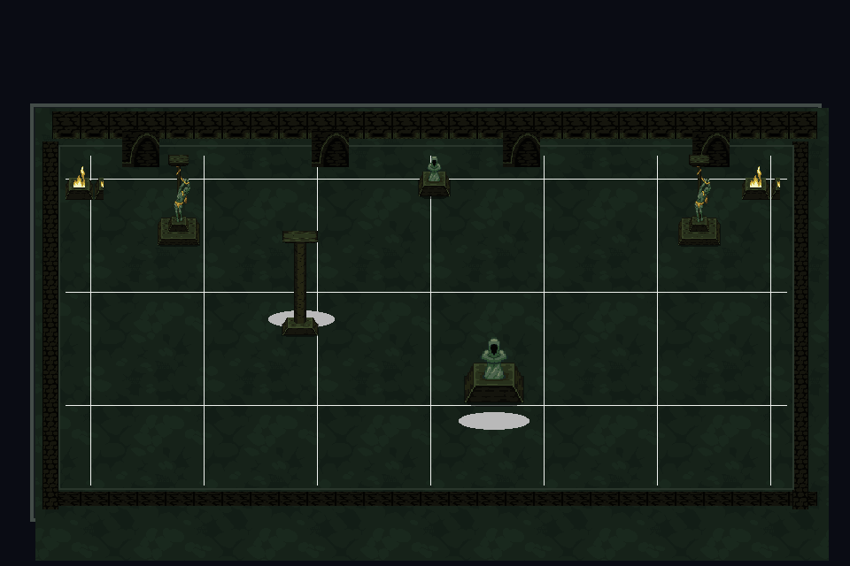

# El Templo de los Ecos

**Un lugar sagrado. Un sistema oculto. Un ciclo del que quizás no exista escapatoria.**

[](https://github.com/je7remy/el-templo-de-los-ecos/releases)
[](https://godotengine.org/)
[](https://github.com/je7remy/el-templo-de-los-ecos/actions/workflows/validar-godot.yml)
[](https://github.com/je7remy/el-templo-de-los-ecos/releases)

**El Templo de los Ecos** es un proyecto independiente de terror psicológico y cósmico, supervivencia y elementos roguelite, desarrollado en **Godot Engine 4** con **GDScript**. El jugador explora un templo cuyo funcionamiento desconoce: las entidades responden a reglas específicas y el conocimiento adquirido es tan valioso como las habilidades.

> **Estado:** prototipo de un solo piso (cinco habitaciones). Las misiones, entidades y estadísticas del prototipo no constituyen canon definitivo del universo. No es un juego terminado.

## Vista del escenario



*Fondo de habitación elaborado con recursos de Knowledge Temple; no es una captura de una partida en ejecución.*

## ¿Qué incluye el prototipo?

- Un primer piso de **cinco habitaciones**, una misión y encuentros experimentales.
- Entidades representadas con los sprites originales **Angel, Burning Ghoul y Skeleton Wizard** de GothicVania Church Pack.
- Escenarios, altares y decoración procedentes de **Knowledge Temple**.
- Exploración, interacción con objetos, recolección de almas y habilidades experimentales.
- **Muerte 50/50:** reencarnación de la misma persona o absorción definitiva del alma, con aparición posterior de un nuevo humano.
- Persistencia del conocimiento y de las habilidades adquiridas después de una reencarnación; el nivel de habilidad se restablece a cero.
- Pruebas automatizadas con Godot 4.3 para importar sprites, abrir escenas y recorrer el flujo básico.

La idea narrativa central es que el templo no es una prisión convencional: forma parte de un sistema de explotación de almas. El antagonista permanece fuera de escena mientras el sistema continúa funcionando.

## Descargar y ejecutar en Fedora / Linux

La [sección Releases](https://github.com/je7remy/el-templo-de-los-ecos/releases) ofrece **el proyecto fuente**, no un ejecutable listo para instalar. Descarga el archivo ZIP de código fuente, descomprímelo y abre `project.godot` con Godot 4.3 o superior.

También puedes clonar el repositorio:

```bash
git clone https://github.com/je7remy/el-templo-de-los-ecos.git
cd el-templo-de-los-ecos

# Importación inicial de texturas
godot --headless --path . --import

# Jugar
godot --path .
```

Para abrir el editor:

```bash
godot --editor --path .
```

Si Godot está instalado por Flatpak, sustituye `godot` por `flatpak run org.godotengine.Godot`. También está disponible `bash herramientas/abrir_fedora.sh`.

## Controles

| Tecla | Acción |
| --- | --- |
| Enter | Iniciar o reiniciar |
| W / A / S / D o flechas | Moverse |
| E | Interactuar, recoger, abrir puertas |
| F | Encender o apagar la linterna |
| Espacio | Esquivar |
| Q | Resonancia (después de adquirirla) |
| Esc | Volver al menú o cerrar un panel |

**Recorrido de prueba:** Umbral del despertar → Claustro de las ofrendas → Sala del Testigo → Archivo de los ausentes → Pórtico del siguiente piso. Algunas reglas de los enemigos todavía son provisionales.

## Estructura del proyecto

```text
assets/                 Arte del escenario, sprites de enemigos y protagonista provisional
audio/                  Audio del prototipo
scenes/                 Escena principal
scripts/                Lógica de juego en GDScript
tests/                  Pruebas de humo para Godot sin interfaz
herramientas/           Scripts de validación y apertura en Fedora
docs/                   Decisiones de diseño, licencias y notas de versión
.github/workflows/      Integración continua y publicación de alpha
project.godot           Configuración del motor
```

## Progreso, pruebas y limitaciones

- **Versiones:** [registro de cambios](CHANGELOG.md) · [lanzamientos](https://github.com/je7remy/el-templo-de-los-ecos/releases).
- **CI:** [verificación automática](https://github.com/je7remy/el-templo-de-los-ecos/actions/workflows/validar-godot.yml).
- Los fondos son composiciones 2D, **todavía no** mapas editables en TileMapLayer.
- Los enemigos son sprites originalmente dibujados de perfil y su integración top-down es provisional.
- El protagonista utiliza un sprite provisional; no se ha integrado Mark.
- Las pruebas automatizadas no sustituyen una partida manual: Godot 4.3 todavía puede avisar de recursos retenidos al cerrar en modo headless.

## Créditos y uso de los assets

- **Knowledge Temple — pingupollas:** escenario y decoraciones. [Página original](https://pingupollas.itch.io/knowledge-temple). El autor **exige crédito** y permite usar/modificar el material en proyectos personales y comerciales, pero **prohíbe redistribuir el pack como un paquete de recursos independiente**. Los recursos integrados aquí no se ofrecen como paquete de sprites.
- **GothicVania Church Pack — Luis Zuno (Ansimuz):** Angel, Burning Ghoul, Skeleton Wizard y proyectiles. [Página original](https://ansimuz.itch.io/gothicvania-church-pack) · [Publicación CC0](https://opengameart.org/content/gothicvania-church-pack). Atribución voluntaria y apreciada.

**Importante:** las licencias de terceros no significan que todo el código y el universo narrativo del juego estén licenciados bajo CC0. Consulta [assets y licencias](docs/ASSETS_Y_LICENCIAS.md) antes de reutilizar el contenido.

---

Desarrollado por [@je7remy](https://github.com/je7remy). **Versión de trabajo: v0.3.1-alpha** (correcciones y documentación de la v0.3).