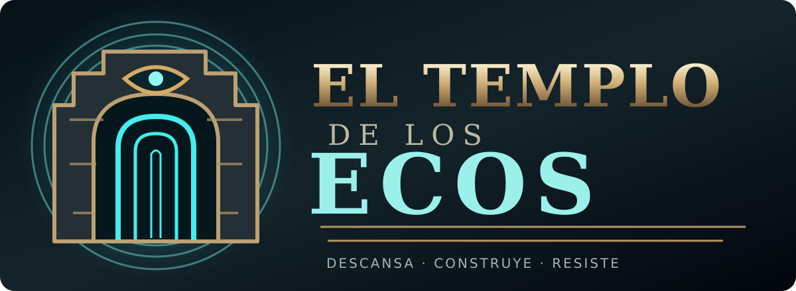

# El Templo de los Ecos — v0.4.1 Alpha (Vigilia ampliada + Android)

**Lanzamiento experimental con APK Android ARM64 de depuración.** Se mantiene la campaña de terror y supervivencia original y se amplía el modo alternativo de defensa, inspirado en mecánicas generales del género de Haunted Dorm, sin copiar su arte, código, interfaz exacta ni personajes.

## Novedades jugables

- **Dos modos:** Exploración del templo (cinco salas, misión del sello, criaturas, almas y reencarnación 50/50) y **Vigilia del Claustro** (economía, construcción y protección de una puerta).
- **Tres cámaras con efectos reales:** Umbral genera +1 eco/s, Claustro comienza con 125 puntos extra de resistencia en la puerta y Archivo concede 8 puntos de energía inicial.
- **Economía estratégica:** descansar para recibir ecos; construir generadores para conseguir energía; mejorar camas, puertas, centinelas y daño; usar escudos temporales y reparaciones.
- **Oleadas de entidades**, variación de sprites de Ghoul, Wizard y Angel, puntuación, registro de mejor marca y reinicios.
- **Botones táctiles diferenciados** de Explorar/Vigilia en el menú, joystick y accesos táctiles para los dos modos.
- **Logo y emblema vectoriales propios** coherentes con el horror cósmico y religioso del templo.

## Calidad y validación

El proyecto incluye tests de importación y sprites, campaña, sistemas de derrota/reencarnación, controles táctiles sintéticos, economía y lógica defensiva, logo/icono, y una simulación completa de 135 segundos que verifica que se puede ganar con una estrategia de construcción y perder si se abandonan las defensas.

GitHub Actions genera el APK únicamente cuando termina la validación. El pipeline comprueba el archivo generado, la integridad ZIP, su firma Android y la identidad/versión del paquete mediante AAPT.

**Limitaciones todavía presentes:**
- Queda pendiente validar rendimiento, visualización y precisión de los controles **en un teléfono físico**.
- Las pruebas Godot sin interfaz aún pueden imprimir avisos de recursos retenidos durante la salida del proceso; no se han identificado fallos de ejecución del juego causados por esos avisos.
- El diseño y el equilibrio siguen sujetos a pruebas de usuarios. Se trata de una **alpha jugable**, no de un producto comercial concluido.
- Sin iOS, multijugador, publicidad ni integración en Google Play.

## Instalar en Android

Descarga **ElTemploDeLosEcos-Android-Debug.apk** de esta página, ejecuta el archivo y autoriza temporalmente instalar apps desde esa fuente si Android lo solicita. Utiliza el móvil en horizontal. Es una build de desarrollo ARM64, **no** una app de Google Play.

Cada compilación automática emplea una firma de depuración temporal. Una actualización sobre un APK instalado con otra firma puede exigir desinstalar la versión anterior, perdiendo los datos locales; **no desinstales sin respaldar el progreso que quieras conservar**.

## Escritorio

Sincroniza el repositorio, abre `project.godot` con Godot 4.3+ y ejecuta la escena principal. En el menú: Enter = Explorar, H = Vigilia.

## Créditos

Knowledge Temple — pingupollas (crédito obligatorio): https://pingupollas.itch.io/knowledge-temple

GothicVania Church Pack — Luis Zuno / Ansimuz: https://opengameart.org/content/gothicvania-church-pack

El código de Vigilia, el emblema vectorial y el universo del templo se desarrollaron para este proyecto. Consulta `docs/ASSETS_Y_LICENCIAS.md` para condiciones de redistribución de assets.
